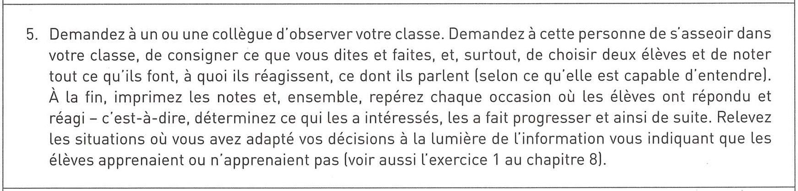
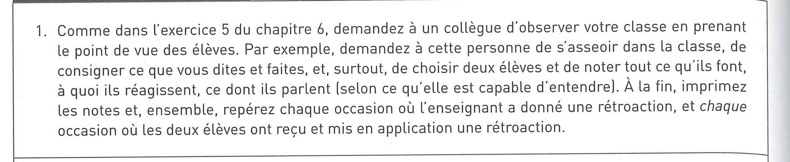
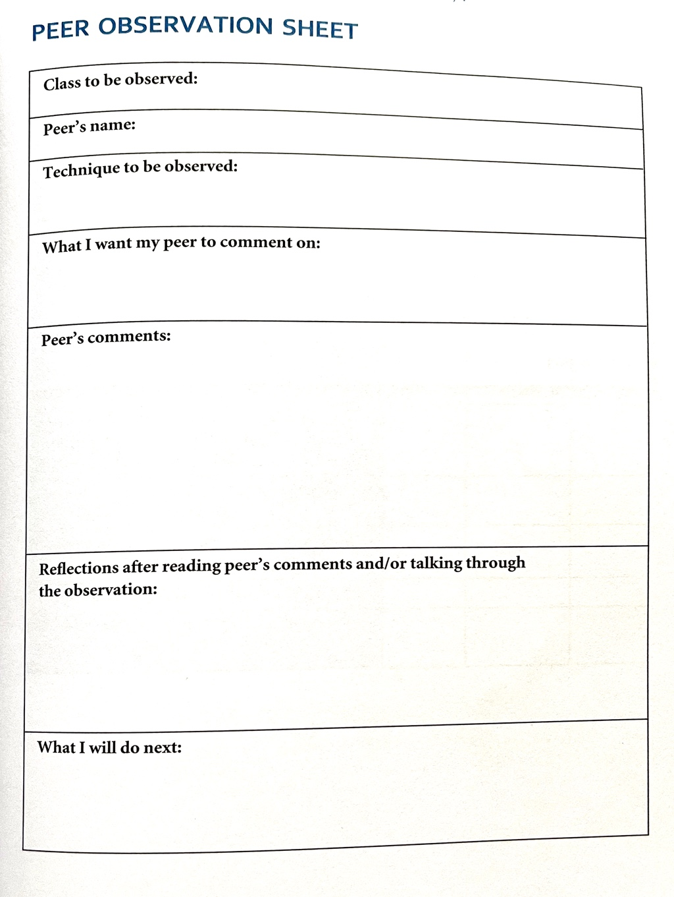

Quelques idées de structure pour une visite / observation de cours:

Exemples tirés de John Hattie: *L'apprentissage visible pour les enseignants* (2017)

Fiche tirée de Dylan Wiliam, *Embedding Formative Assessment* (2015)

L'Université de Genève décrit ainsi l’observation entre pairs (*Peer Observation of Teaching*):

> Selon ce modèle, deux personnes qui enseignent (ou plus) collaborent pour développer ensemble leurs compétences en enseignement. Leur collaboration prend la forme d’observations mutuelles de leurs classes, précédées et suivies de discussions et de réflexions. Ces discussions débouchent le plus souvent sur l’échange à propos des stratégies et des techniques d’enseignement.
>
> Dans cette perspective collaborative, il n’est nullement question d’évaluer les compétences des personnes ou de porter un jugement sur la qualité des cours. Il s'agit plutôt de se donner un feed-back constructif et de rechercher des pistes permettant d'évoluer et de se développer en tant qu’enseignant-e universitaire.

Source: [Université de Genève](https://www.unige.ch/dife/enseigner-apprendre/programme/ressources/observation-pairs/) - avec des ressources à télécharger (diverses grilles d'observation).