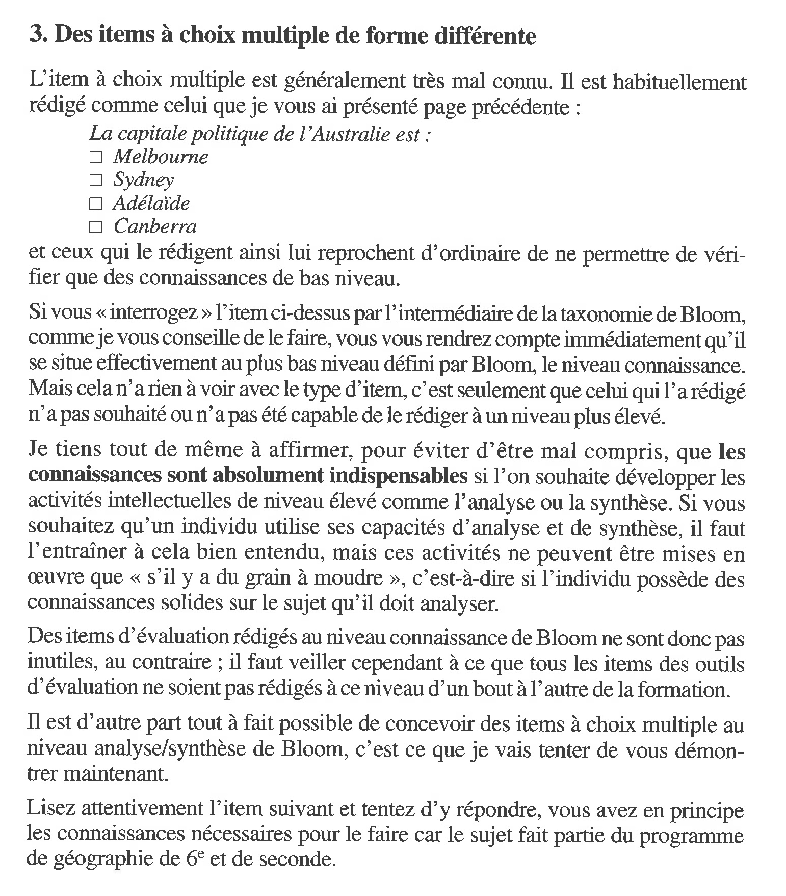
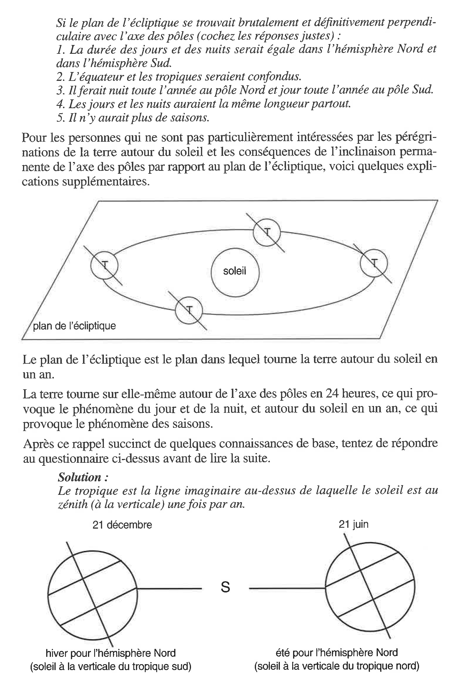
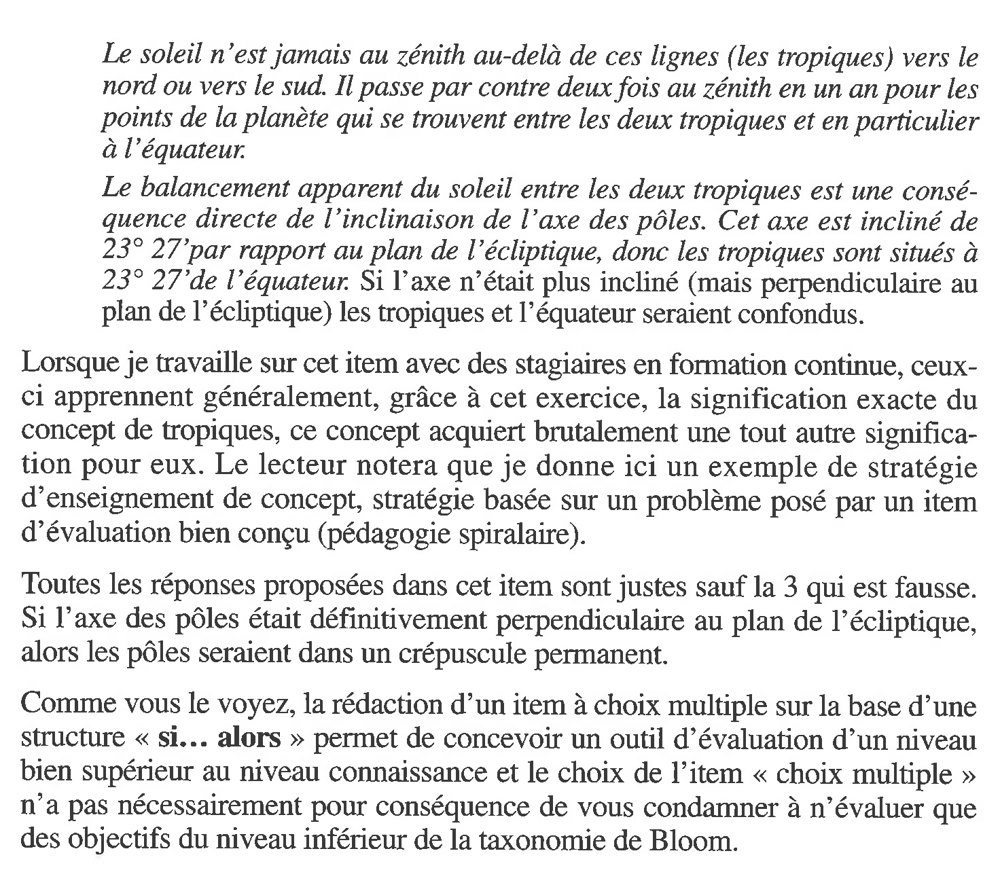
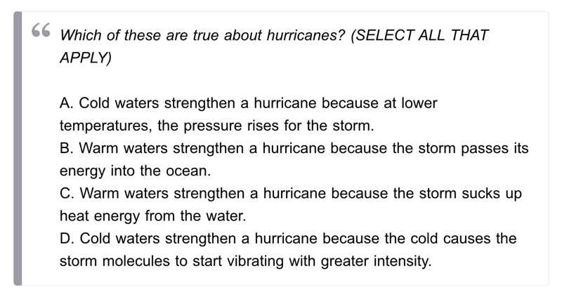

### Comment concevoir de bonnes questions

Le questionnaire, sous forme de "Questions à choix multiples" (QCM), est un format qui présente l'avantage de la facilité d'évaluation. Il est toutefois fréquent que les questions ne testent qu'un savoir superficiel de mémorisation de termes, et pas de compréhension plus profonde.

#### Rédaction d'un item à choix multiple

Voici un extrait du livre d'Alain Rieunier, *Préparer un cours* (2001). Rieunier montre que l'item à choix multiple bien conçu permet d'évaluer un niveau cognitif supérieur.

#### Recommandations de Podsie

Les ressources pédagogiques de l'outil Podsie comportent une page de conseils sur la formulation de questions: *[Write Good Questions](https://podsie.tawk.help/article/write-good-questions)*.

Une recommandation consiste à opter pour le format "Select All That Apply" (Choisir toutes les réponses qui s'appliquent):

 

