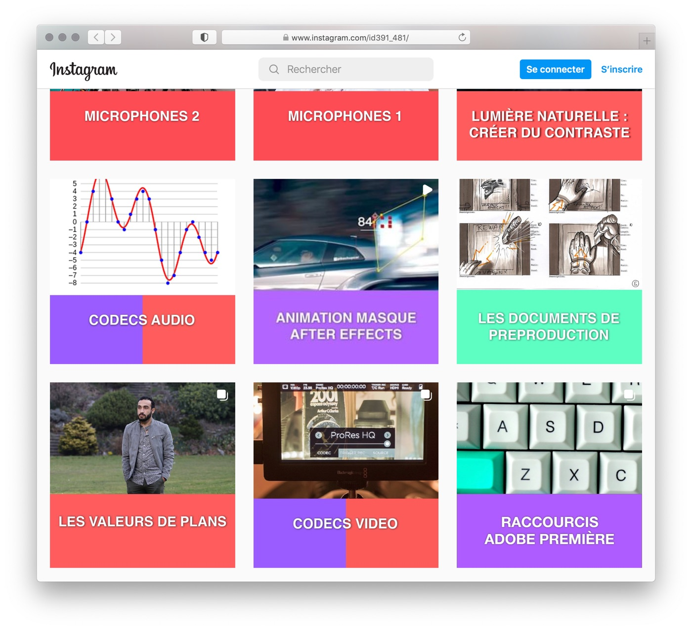

## Activité: création d'un support d'apprentissage (ou de révision) par les élèves

Dans cette activité, l'enseignant-e se situe dans un *strict rôle de mentor*, annoncé clairement au début : pointer les erreurs factuelles à remédier, demander des explications ou compléments et assurer le respect des délais.

## Exemples d'application

- Printemps 2021, cours "Révision Médias Interactifs" donné à deux classes ID par Chau-Uyen Mai et Manuel Schmalstieg. Documentation du cours: [https://cours-web.ch/cours-revision/](https://cours-web.ch/cours-revision/)
- Printemps 2022, cours "Révision Audiovisuel" donné à deux classes ID par Philippe Cordey, sur 8 x 4 périodes. Supports produits par les élèves: [https://www.instagram.com/id391_481/](https://www.instagram.com/id391_481/)

 

