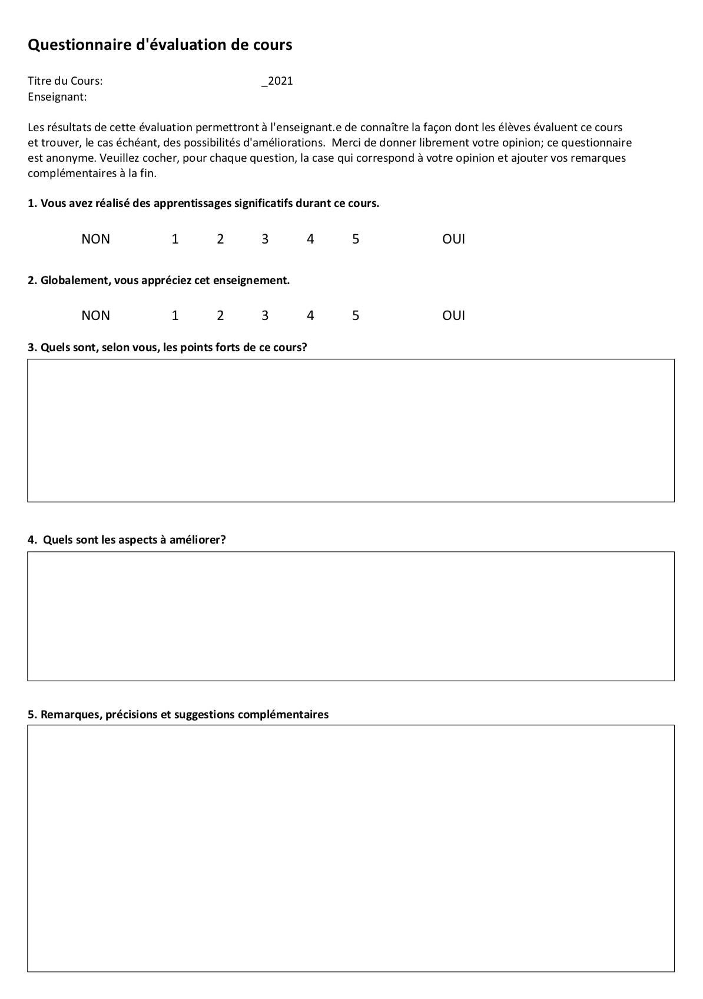
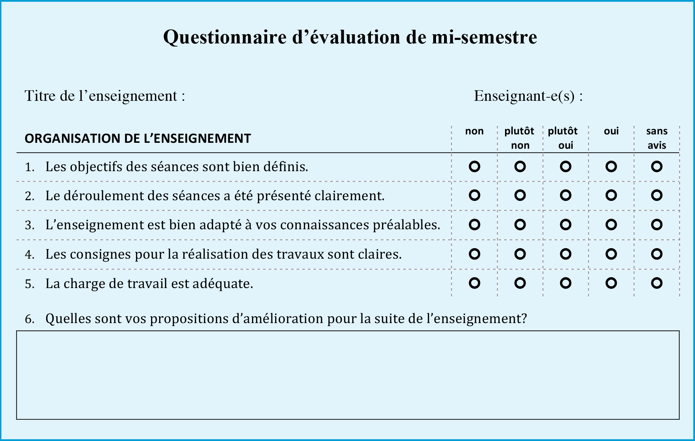
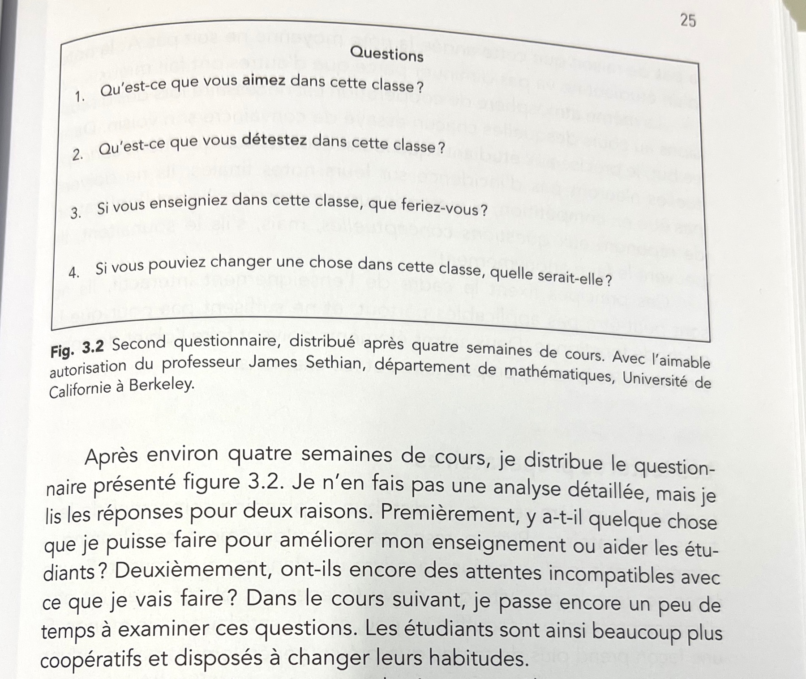
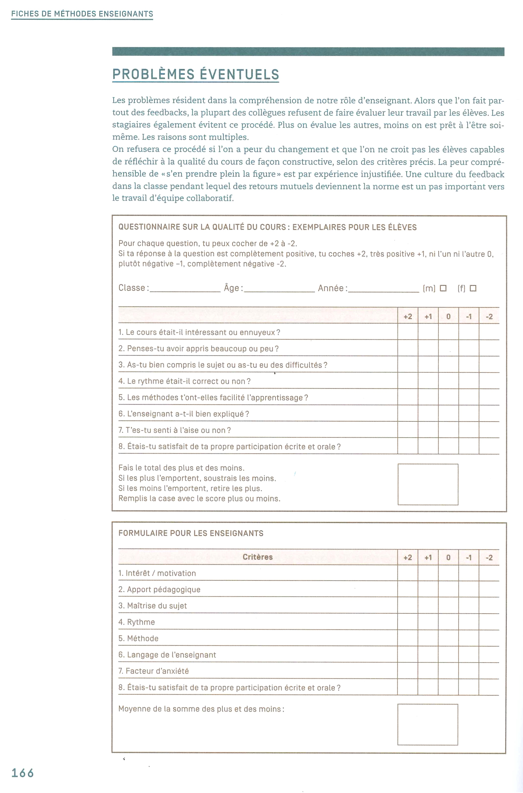

Ressources pour l’évaluation par les élèves.

> Les feedbacks sur le cours nous fournissent à nous, enseignants, une quantité d'informations importantes. Ils montrent de façon claire comment notre cours a été perçu par les élèves. On devrait profiter de cette opportunité. Elle permet de mieux connaître le public visé et nous offre des pistes d'amélioration. Le feedback a également des effets positifs sur la relation enseignant-élèves car les élèves apprécient beaucoup que l'enseignant les prenne au sérieux et qu'il s'intéresse à leur condition.

Source: [Mattes & Danquin (2015)](img/evaluation-par-eleves/p165-feedback-qualite.jpg).

## Exemples de formulaires

### Quelques formulaires utilisés à l'Eracom

- Un formulaire simple composé de 5 questions ([télécharger le PDF](img/evaluation-par-eleves/eracom-eval-cours-5q.pdf))
- Le même formulaire de 5 questions, au format [questionnaire Microsoft Forms que vous pouvez dupliquer](https://forms.office.com/Pages/ShareFormPage.aspx?id=CLlqkPkEgEq6nIdaNud7wWhMFfhVGJdGpfZSv8KAoIlUM0pHMURLMkNWN1pVSjBZTjU1VVoyU0hSNy4u&sharetoken=go4wbDOB9zMjWHsv2tO0).
- Un formulaire très complet, composé de 19 questions ([télécharger le PDF](img/evaluation-par-eleves/eracom-eval-cours-19q.pdf)).

### Formulaires proposés par l'UNIL

Le Centre de soutien à l'enseignement (CSE) de l'UNIL [propose différents modèles](https://www.unil.ch/cse/fr/home/menuinst/nos-prestations/evaluer-votre-enseignement.html). Ci-dessous, deux modèles: Questionnaire de mi-semestre, et Questionnaire qualitatif:

### Autres exemples de formulaires

Un questionnaire proposé par Eric Mazur (📚*Peer Instruction*, 2014). C’est un questionnaire que l’auteur soumet à sa classe “après environ quatre semaines de cours”:

 

Un formulaire proposé par Mattes & Danquin (2015), pour l'évaluation d'un cours par les élèves:

Un questionnaire proposé par Hattie & Clarke (2019) dans 📚*Visible Learning Feedback*. Cela se résume à trois questions (p. 126):

- Has your learning improved so far in Year N? How? 
- How has your teacher helped you to learn? 
- What could your teacher do differently to help you learn? 

Un autre exemple cité dans le même livre (p. 130), où l'enseignant-e pose deux questions:  

- What did I do that helped you understand? 
- What could I have done to help you understand better? 

## Autres méthodes de feedback

Le feedback des élèves ne doit pas obligatoirement passer par un **questionnaire écrit**. Il est possible de recourir à un dispositif de **feedback de groupe**:

- Via un *Grupo Operativo* (méthode proposée par Jean-Luc Zimmermann dans *Gérer un groupe de formation et d’enseignement*).
- Via les 🔁 *Feedback Methods* de DasArts ([voir le site dédié](https://cours-web.ch/feedback/)). Vous pouvez par exemple faire une session de 15 minutes qui combine *Affirmative Feedback*, *Perspectives Feedback*, et *Personal Letter*.
- Via un format de *Rétrospective Agile* ([voir site dédié](https://cours-web.ch/agile/)).

## Références 📚

- Document dans Teams ([ERACOM_ID_Teams > Documents > Ressources enseignement > Evaluation par élèves](https://eduvaud.sharepoint.com/:f:/s/ERACOM_ID_Teams/EtenecP5pgNOmfPPpNGEsjoBkG7XO-fe6wAz8H3LY5pxDg?e=XbOk07))
- Mazur, E. (2014). *Peer Instruction. Une méthode éprouvée d’enseignement interactif*. Presses polytechniques et universitaires romandes.
- Mattes, W. & Danquin, R. (2015). *52 méthodes : Pratiques pour enseigner*. Schöningh Verlag, Réseau Canopé. 
- Hattie, J. & Clarke, S. (2019). *Visible Learning: Feedback*. Routledge.