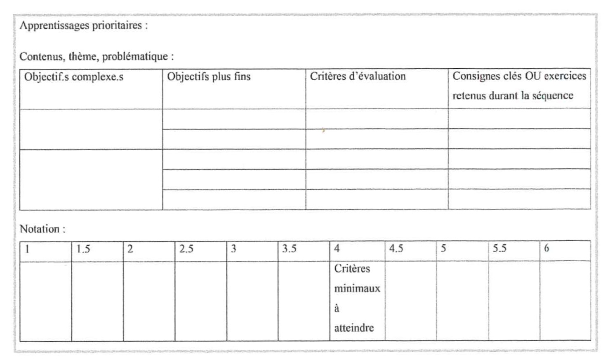
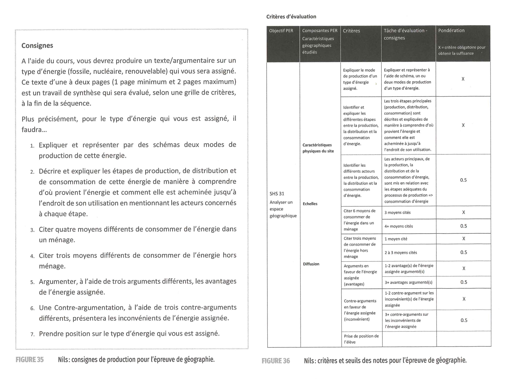

Voici quelques éléments sur la manière de "construire les notes". Ces informations proviennent d'un livre de Raphaël Pasquini, "Quand la note devient constructive" (2021).

Dans son livre, Pasquini développe une réflexion et propose des méthodes pour produire des notes "constructives".

## Une vidéo de présentation du livre

<iframe width="100%" style="ratio:16/9; min-height:320px" src="https://www.youtube-nocookie.com/embed/jcRJIb1bG8s" title="YouTube video player" frameborder="0" allow="accelerometer; autoplay; clipboard-write; encrypted-media; gyroscope; picture-in-picture" allowfullscreen></iframe>

***

L'utilité des notes a longtemps fait débat dans l'enseignement, et elle reste une préoccupation importante, pour les enseignant-es comme pour les élèves.

Pour Pasquini, les débats "pour ou contre la note" ont peu d'intérêt. Malgré ses défauts, la note reste "l'information la plus concrète que les élèves puissent obtenir sur les bilans de leurs apprentissages".

Souvent, le problème n'est pas la note en soi, mais les incohérences de ses modes de construction. Pasquini propose de changer cela, en trouvant le moyen de mieux *référer la note à l'apprentissage*.

Ainsi pensée, la note remplira trois fonctions:

- Certifier les apprentissages considérés comme importants.
- Fournir des rétroactions formatives aux élèves.
- Donner des informations à l'enseignant-e pour planifier les apprentissages.

Pour que la note soit "référée à l'apprentissage", l'enseignant-e doit soigneusement évaluer le rôle des échelles et des barèmes. Le seuil le plus délicat à déterminer étant celui de la note "suffisante".

## Problèmes fréquents avec les notes

Le chapitre 4 présente deux exemples d'évaluations sommatives "classiques": une épreuve d'allemand, et une production écrite (cours de français).

Les problèmes relevés, qui sont des problèmes très fréquents:

- Attribution de points hasardeuse. Le nombre de points donnés pour un exercice ne reflète pas l'effort cognitif de la tâche.
- Phénomène de compensation (qui brouille les informations). Une note suffisante peut être obtenue malgré des lacunes.
- Absence de critères, ou inconsistence des critères entre eux.

## Pour une note référée aux apprentissages

La solution pour éviter ces problèmes: élaborer la note **sur la base de critères**.

Un avantage immédiat: le fait de baser la note sur des critères, plutôt qu'une addition de points, permet de "formuler des rétroactions" (= donner un feedback précis à l'élève). Indiquer quels critères ne sont pas remplis, cela permet une "prise d'information qualitative".

> Il est plus constructif de dire à l'élève **sur quel critère** il a échoué, que de lui décompter le nombre de points qui ont manqué.

Ce qu'on entend par "notation référée aux apprentissages":

- Les critères doivent être liés à des objectifs.
- Les critères doivent mesurer l'acquisition des apprentissages.
- Tout critère doit être mis en lien avec la pratique.
- La pondération doit refléter l'importance des tâches (les habilités cognitives).
- L'utilisation de critères devrait être récurrente. Les élèves peuvent ainsi s'approprier les critères.

### Manières de construire les critères

Pasquini définit quatre manières de construire des critères:

#### 1) Critères centrés sur les tâches.

Problème de cette approche:  
On évolue dans un niveau de complexité bas. L'élève est poussé à respecter la consigne, de suivre une procédure, plutôt que d'analyser un problème et d'avoir une réflexion autonome.  
De tels critères appellent l'utilisation de points, de manière mathématique.  

#### 2) Critères analytiques

La tâche à accomplir est "disséquée" (par exemple: "cohérence de l'introduction"): on perd la vision d'ensemble du travail.  
Le phénomène de compensation va opérer.

#### 3) Critères holistiques 

Exemple de critère holistique : "cohérence" d'une production.  
Cela donne l'avantage d'un jugement plus général.  
Les critères requièrent une description verbale des caractéristiques essentielles.  
Le niveau de généralité permet peu de rétroaction.  
À cause de ce caractère général, des biais peuvent apparaître lors de la correction. Voir: [Biais d'évaluation](biais-evaluation.html)

#### 4) Critères holistiques élargis

Ici, les critères sont accompagnés d'une **échelle descriptive**, qui détaille les caractéristiques essentielles dans une perspective **qualitative** (plutôt que quantitative).

Cette échelle descriptive est incontournable pour construire une note référée à l'apprentissage.

En résumé, les critères doivent être 

- Pertinents (en rapport avec la pratique, ce qui a été travaillé)
- Indépendants (sans recoupement entre eux)
- Peu nombreux

## Exemples d'épreuves

Pasquini présente trois exemples d'épreuves qui ont été élaborés selon ce modèle, par des enseignant-es qu'il a accompagné.

- [épreuve d'expression écrite](img/eval-constructive/criteres-expression-ecrite.jpg).
- [épreuve de géométrie](img/eval-constructive/epreuve-isometrie.jpg).
- [épreuve de géographie](img/eval-constructive/criteres-geographie.jpg).

On peut observer des points communs dans la construction de ces trois épreuves.

Les critères des épreuves (de géométrie et de géographie) sont reliés à des objectifs bien définis, en lien avec le curriculum.

Les critères sont divisés en "critères de base" (obligatoires), et "critères de perfectionnement" (ou d'approfondissement).

- Les **critères de base** doivent tous être validés pour atteindre le seuil de suffisance (4). "Il n'y a pas d'échelle de notation proprement dite, puisque la validation de tous les critères obligatoires donne une note de 4."
- Les **critères de perfectionnement** donnent les notes et demi-notes supérieures.

On peut donc représenter le barème ainsi, en fonction des critères validés :

| Critères de base   | Critères d'approfondissement | Note |
|:----------------- |:---- |:---- |
| Tous              | 4    | 6    |
| Tous              | 3    | 5,5  |
| Tous              | 2    | 5    |
| Tous              | 1    | 4,5  |
| Tous              | 0    | 4    |
| -1 critère        |      | 3,5  |
| -2 critères       |      | 3    |
| -3 critères       |      | 2,5  |
| -4 critères       |      | 2    |

## Pas de critères universels

La construction des critères est un travail important que seul l'enseignant-e peut réaliser: il est impossible de fournir une "banque de critères" qu'on mettrait à disposition.

> Imposer les mêmes critères à tous reviendrait à imposer un modèle didactique unique, ce qui est impossible [...]; connaîre les critères des autres ne signifie pas qu'on se les soit appropriés (Georgette Nunziati, 1990)

## Ressources

Ceci est un résumé du livre, que vous trouvez en bibliothèque Eracom-Epsic, à la cote 371 - voir [Livres Pédagogie](https://code.eracom-pedagogique.ch/livres-imd/pedagogie.html).

🌐 [Lien OneDrive pour voir quelques extraits](https://eduvaud-my.sharepoint.com/:f:/g/personal/pr51kln_eduvaud_ch/ErR2tA1EpWFJpyrRBzLHHuoBAmSGA3aZ2uqNjoDiMkWEiw?e=jFE9th).